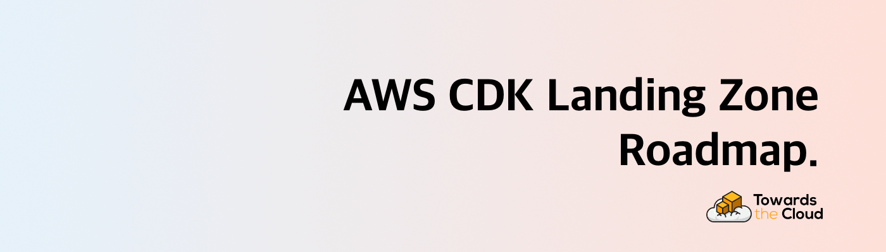

# AWS CDK Landing Zone Roadmap

> This is the public roadmap for the AWS CDK Landing Zone product, built and deployed by [Towards the Cloud](https://github.com/towardsthecloud).
>
> - [Product overview](https://towardsthecloud.com/services/aws-cdk-landing-zone)
> - [Roadmap project board](https://roadmap.towardsthecloud.com)

## What is the AWS CDK Landing Zone?

A production-ready, multi-account AWS foundation (security, logging, guardrails, and account provisioning) delivered entirely as Infrastructure as Code in AWS CDK TypeScript. Built for B2B startups and growing teams that need to become audit-ready fast while keeping full control over their infrastructure.

## Why Not AWS Control Tower?

AWS Control Tower is a common starting point, but teams run into its limits quickly:

| **Challenge**           | **AWS Control Tower**                                                          | **AWS CDK Landing Zone**                                                 |
| ----------------------- | ------------------------------------------------------------------------------ | ------------------------------------------------------------------------ |
| **Cost**                | High base cost. Enables many services by default whether you need them or not. | Pay only for what you use. Enable services selectively.                  |
| **Customization**       | Limited. You wait for AWS to support new features and configurations.          | Full control. Customize anything immediately in native AWS CDK.          |
| **Management**          | ClickOps in the AWS Console: manual, error-prone, hard to audit.               | GitOps-first. Every change goes through code review and is repeatable.   |
| **Drift & Consistency** | Manual drift detection, hard to enforce the desired state.                     | Daily automated drift detection against the version-controlled baseline. |
| **Vendor Lock-in**      | Tied to AWS's implementation decisions and timeline.                           | You own the code. Extend, modify, or migrate whenever you want.          |

**Bottom line:** Control Tower trades flexibility for convenience. If you need a compliant AWS foundation that you actually control, the AWS CDK Landing Zone gives you the same security posture without the rigidity or the hidden costs.

## Why teams pick the AWS CDK Landing Zone

### 1. Full compliance out of the box

- Multi-account architecture with security controls and compliance guardrails from day one
- Scores **100%** on the CIS AWS Foundations Benchmark and **96%** on AWS Foundational Security Best Practices
- These benchmarks map directly to SOC 2, HIPAA, and PCI-DSS controls, cutting months from your compliance timeline

### 2. Secure guardrails

- Pre-configured security policies based on AWS best practices
- Risky actions are blocked automatically, protecting both your business and your budget

### 3. Everything as Infrastructure as Code

- Written completely in AWS CDK TypeScript
- GitOps-first deployments, for example through GitHub Actions

### 4. Single Sign-On integration

- Sets up AWS IAM Identity Center with external identity providers
- Works with Entra ID, JumpCloud, or the built-in AWS identity store
- One place to manage who can access which AWS account

### 5. Batteries included

- CloudFormation StackSets provision every AWS account in the organization automatically, multi-region included
- Observability and notifications are wired in so you stay in control
- Workload accounts arrive CDK-bootstrapped, so your team can start deploying on day one

## AWS CDK Landing Zone Features

Here's everything that ships in the AWS CDK Landing Zone today:

| **Feature**                               | **Description**                                                                                                                                                                                                          |
| ----------------------------------------- | ------------------------------------------------------------------------------------------------------------------------------------------------------------------------------------------------------------------------ |
| **SECURITY & COMPLIANCE**                 |                                                                                                                                                                                                                          |
| **Centralized Root Access**               | Member accounts carry no standalone root credentials. Root is managed centrally, so a lost or misused root password can no longer put an account at risk.                                                                |
| **Organization CloudTrail**               | A single organization-wide audit trail records activity across every account, including the management account, and raises alarms on high-risk events like root usage and unauthorized API calls.                        |
| **GuardDuty Threat Detection**            | Amazon GuardDuty watches every account around the clock for compromised instances, unauthorized access, and unusual API activity, with findings centralized for your security team.                                      |
| **Security Hub Posture Management**       | Aggregates security findings from across the organization into one dashboard and continuously scores every account against AWS and CIS benchmarks, managing the underlying AWS Config setup for you.                     |
| **Vulnerability Scanning**                | Amazon Inspector continuously scans EC2 instances, container images, and Lambda functions for known vulnerabilities across the organization.                                                                             |
| **Sensitive Data Discovery**              | Amazon Macie inspects your S3 estate for exposed sensitive data, so accidental exposure is caught before it becomes an incident.                                                                                         |
| **EBS Encryption by Default**             | Every new EBS volume is encrypted at rest automatically, with nothing for workload teams to configure.                                                                                                                   |
| **S3 Block Public Access**                | Account-level public access blocking prevents any bucket or object from being exposed to the internet by mistake.                                                                                                        |
| **Strong IAM Password Policy**            | Enforces minimum length, expiry, reuse prevention, and complexity requirements on every account.                                                                                                                         |
| **Secure Defaults**                       | Every account inherits the same hardening in one step: default VPC removed, EBS encryption on, public S3 access blocked, default security groups locked down, and a strict password policy applied.                      |
| **Centralized Log Archive**               | CloudTrail and compliance data land in a dedicated, encrypted Log Archive account with access logging and lifecycle rules for compliant, tamper-resistant retention.                                                     |
| **Encrypted Alerting**                    | Security and compliance notifications flow through KMS-encrypted SNS topics scoped to your organization, so alerts reach the right people without exposing data.                                                         |
| **AUTOMATED ACCOUNT PROVISIONING**        |                                                                                                                                                                                                                          |
| **Instant Account Provisioning**          | New accounts arrive ready to deploy to, with CDK bootstrap, encrypted asset storage, and a container registry already in place, so teams ship on day one.                                                                |
| **Alternate Contacts**                    | Security, billing, and operations contacts are set on every account automatically, so AWS notifications always reach the right people.                                                                                   |
| **Marketing Email Opt-Out**               | New accounts are unsubscribed from AWS marketing email automatically.                                                                                                                                                    |
| **Automated Account Closure**             | Accounts moved to the suspended unit are closed for you, with no manual offboarding steps or forgotten leftovers.                                                                                                        |
| **Default VPC Removal**                   | The default VPC is stripped from every new account and region, so workloads run only in networks you designed.                                                                                                           |
| **OPERATIONS & COST OPTIMIZATIONS**       |                                                                                                                                                                                                                          |
| **Cost Anomaly Monitoring**               | Detects unusual spending patterns across AWS services and alerts the team immediately, so overspend gets caught early.                                                                                                   |
| **Budget Alerts**                         | Budgets notify you when actual or forecasted spend crosses your thresholds, keeping cost surprises off the invoice.                                                                                                      |
| **Service Quota Automation**              | Requests AWS service quota increases automatically as you grow, so limits don't block a launch.                                                                                                                          |
| **GOVERNANCE & DEPLOYMENT**               |                                                                                                                                                                                                                          |
| **Configuration Drift Detection**         | A daily check across the management and landing zone accounts flags anything that has drifted from the version-controlled baseline.                                                                                      |
| **Delegated Administration & Guardrails** | Security services run from a dedicated security account, and organization policy families like SCPs, tag, and backup policies are enabled and governed centrally, keeping day-to-day management out of the root account. |
| **GitHub Actions Pipeline**               | A secure CI/CD pipeline deploys infrastructure changes through pull requests using OIDC, so there are no long-lived AWS keys to store or rotate.                                                                         |
| **AWS Organizations via Code**            | Accounts, organizational units, and Service Control Policies are defined in AWS CDK, so governance changes go through code review and deploy consistently across the organization.                                       |

## Delivery & Maintenance Options

Towards the Cloud deploys the Landing Zone for you as a productized implementation (also available on the AWS Marketplace). After handover, you choose how it's operated:

- **Self-managed**: Your team owns day-to-day operations and upgrades. We stay available for questions about the architecture, code, and operations.
- **Managed service**: We maintain, update, and keep improving the Landing Zone as new features ship.

Compare what's included in each option and see pricing: https://towardsthecloud.com/pricing

## FAQ

**Q: Why did you create this?**

A: So clients can see what's coming and help shape it. Anyone with an active subscription gets new features automatically as they're released.

**Q: Why are there no dates on your roadmap?**

A: Security and operational stability come first. The roadmap shifts as priorities do, and an issue on the board doesn't guarantee the feature lands exactly as proposed.

**Q: What do the roadmap categories mean?**

- **Just shipped**: Recently released features
- **Coming soon**: Expected within a couple of months
- **We're working on it**: In progress but further out
- **Researching**: In the design and planning phase

**Q: How can I provide feedback or ask for more information?**

A: Visit the [product page](https://towardsthecloud.com/services/aws-cdk-landing-zone) or browse the [product docs](https://towardsthecloud.com/docs/aws-cdk-landing-zone).

**Q: How can I request a feature be added to the roadmap?**

A: Existing customers can submit feature requests through [GitHub issues](https://github.com/towardsthecloud/aws-cdk-landing-zone-roadmap/issues).
